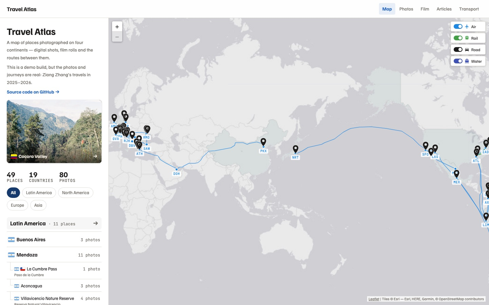
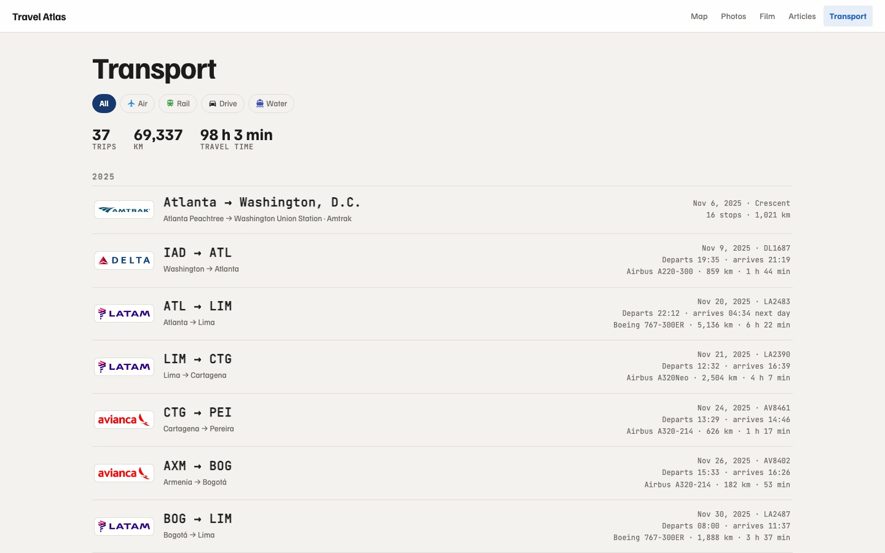
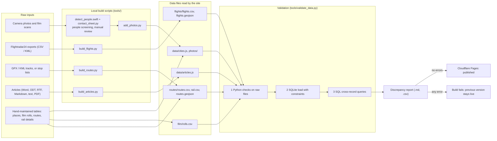

# Travel Atlas

Travel Atlas — an interactive map built on a validated geospatial data pipeline.

**Live site:** https://ziang-atlas.pages.dev

[](https://github.com/Markholmezza/travel-atlas/actions/workflows/validate.yml)

## Screenshots

| Map | Photos |
|---|---|
|  |  |
| **Film** | **Transport** |
|  |  |

## What it does

- **Map**: places on an interactive Leaflet map, grouped by region; country shading and flags.
- **Two-level places**: main places, with smaller places (day trips, passes, nearby towns) listed under their parent.
- **Photos**: a gallery of all photos and a page per place.
- **Film**: film photos grouped by roll, filterable by film stock and camera. The format drives the artwork:
  35 mm rolls rewind into a canister, 120 medium-format rolls onto a spool.
- **Articles**: short articles attached to places.
- **Transport**: flights (from Flightradar24 tracks), rail and road trips drawn on the map with layer toggles,
  plus a transport page that lists every trip with distance and time totals.

## Data pipeline

Content is kept in plain files: JavaScript data files, CSV and GeoJSON. Local build scripts turn raw inputs into
those files. Every push is validated, and the site is published only if validation passes.



| Script | What it does | Input | Output |
|---|---|---|---|
| `tools/detect_people.swift` | Flags photos that show people, using Apple Vision (faces, figures, body poses). | `photos/` (or originals) | `review/detections.json` |
| `tools/contact_sheet.py` | Builds a review page for keeping or removing each photo, from the detections. | photos, detections | `review/contact_sheet.html` |
| `tools/add_photos.py` | Resizes (long edge 2000 px), re-encodes without EXIF (keeping the colour profile), sorts by capture time and numbers photos. Film scans are marked by roll. | `originals/<place>/` (not committed) | `photos/<place>/NN.jpg`, photo lists in `data/cities.js`, new rolls in `film/rolls.csv` |
| `tools/build_flights.py` | Infers flight number, airline, airports and times from each track; simplifies tracks and splits them at the antimeridian; computes local times. | `flights/raw/` (Flightradar24), `tools/airports.csv` | `flights/flights.csv`, `flights/flights.geojson`, airline logos |
| `tools/build_routes.py` | Builds rail and road routes from GPS tracks (trimmed by 500 m at each end) or from stop lists routed with OpenRailRouting / OSRM. | `routes/raw/`, `routes/routes.csv`, `routes/rail.csv` | `routes/routes.geojson`, operator logos |
| `tools/build_articles.py` | Converts articles to paragraphs, headings, bold and italics; a cover photo can be named in the first line. | `articles_inbox/<place>/YYYY-MM-DD Title.ext` | `data/articles.js` |
| `tools/build_changelog.py` | Turns the git history into the site's changelog. | git log, `data/changelog-text.csv` | `data/changelog.json` |
| `tools/validate_data.py` | Runs all checks of the validation plan in three layers and writes the discrepancy report. Exit code 1 on any error. | all data files, `docs/validation_plan.md` | terminal report, `build/validation_report.md`, `.csv` |
| `tools/load_sqlite.py` | Loads every row into SQLite and records each constraint violation (layer 2). | data files, `db/schema.sql` | `build/atlas.db` |
| `tools/atlas_data.py` | Shared readers: a small parser for the JavaScript data files, the validation plan parser and the privacy denylist matcher. | | |
| `tools/test_validation.py` | Tests the rules against deliberately broken datasets. | `tests/fixtures/` | test results |

## Data quality and validation

### Design

The validation follows the structure of a **Data Validation Plan with edit checks**, as used in clinical trial data
management. [`docs/validation_plan.md`](docs/validation_plan.md) is the single list of rules. Each check has:

- an ID (`EC-001` … `EC-055`),
- a category,
- a severity,
- a rationale,
- the layer that implements it.

Code refers to checks only by ID. The validator reads each check's severity from the plan at run time, so code and
plan cannot disagree. Rule changes are recorded in the plan's revision history.

### Three layers

| Layer | Where | Responsible for |
|---|---|---|
| 1. Python checks | `tools/validate_data.py` | Reading the raw files: structure, required fields, formats, ranges, codelists, files on disk, GeoJSON geometry, image metadata, denylisted names |
| 2. SQLite constraints | `db/schema.sql`, `tools/load_sqlite.py` | Loading rows one at a time. PRIMARY KEY, FOREIGN KEY, NOT NULL, UNIQUE and named CHECK constraints (`CONSTRAINT "EC-012:lat"`) reject bad rows. Each rejection is recorded with table, record, constraint and raw value, and the load continues. Rows that depend on a rejected row are skipped, not reported twice. |
| 3. SQL queries | `db/checks/EC-xxx_*.sql` | Cross-record rules: duplicates, the place hierarchy (including cycle detection with a recursive CTE), distances (a haversine function registered from Python), overlapping or implausible flights, completeness |

**Why the same rule is implemented in both Python and SQL.** Row-level rules that can be expressed as constraints
are enforced twice, as defence in depth:

- The Python layer works on the raw files and gives precise messages.
- The database enforces integrity on its own, whatever loads the data.
- When both layers find the same discrepancy, the report lists it once, with `detected by: python, sqlite`.
- A test compares the SQL GLOB patterns with the Python regular expressions on 11,426 generated values, so the two
  layers accept exactly the same identifiers.
- Where the layers deliberately check a rule at different strengths, the plan says so. For example, EC-040 (the
  flight date) is exact in Python, using time-zone data, and a coarse ±1-day bound in SQL.

### Rules by category

| Category | Checks | Errors | Warnings |
|---|---|---|---|
| Structure | 4 | 3 | 1 |
| Required | 4 | 4 | 0 |
| Format | 3 | 3 | 0 |
| Range | 4 | 4 | 0 |
| Enumeration | 5 | 5 | 0 |
| Uniqueness | 4 | 4 | 0 |
| Referential integrity | 9 | 9 | 0 |
| Cross-field consistency | 16 | 13 | 3 |
| Completeness | 4 | 0 | 4 |
| Privacy | 2 | 2 | 0 |
| **Total** | **55** | **47** | **8** |

### Representative rules

| ID | Category | Rule | Layer |
|---|---|---|---|
| EC-012 | Range | Latitudes in [−90, 90] and longitudes in [−180, 180], for places, airports and inline route stops. | Python + SQL constraint |
| EC-011 | Format | Identifiers and codes match their patterns: slugs for place and route ids, IATA codes, flight numbers, roll ids. | Python + SQL constraint |
| EC-027 | Referential integrity | Every film photo's roll exists in `film/rolls.csv`. | Python + SQL constraint (foreign key) |
| EC-024 | Uniqueness | A flight is not entered twice: no two flights share flight number, date and departure airport. | SQL query |
| EC-038 | Cross-field consistency | A place lies inside its country's reference extent; swapped latitude and longitude, or a lost minus sign, are named as such. | Python |
| EC-040 | Cross-field consistency | A flight's date is the local departure date at the departure airport. | Python (exact) + SQL constraint (±1 day) |
| EC-054 | Privacy | No image carries EXIF, GPS, XMP or IPTC metadata (JPEG, PNG and WebP blocks are parsed with the standard library). | Python |
| EC-055 | Privacy | No published file or path contains a name from the privacy denylist. The denylist is a CI secret, and matches are reported as `***`. | Python |

### Errors and warnings

- **Errors block publishing.** `validate_data.py` exits with code 1. The Cloudflare Pages build command runs the
  validator, so the build fails and the previous deployment stays live.
- **Warnings are reported for review and do not block.** Examples: a place without photos, a route without a date.
- **Where the report appears:** the terminal (one line per discrepancy, e.g.
  `[EC-012] error locations zurich lat=-132.8 Latitude out of range [-90, 90]`), a Markdown and CSV discrepancy
  report, and the GitHub Actions job summary and artifact.

### Tests

`python3 tools/test_validation.py` runs 102 tests with the standard library `unittest`.

- **One broken dataset per rule.** `tests/fixtures/_base` is a small, clean site and must raise no error and no
  warning (a negative control). Each check has a fixture containing exactly one deliberate error, and the test
  asserts that the errors raised are exactly the expected ones: the rule fires, and nothing else breaks. Two
  regression fixtures (`OK-001`, `OK-002`) cover valid edge cases that once caused or could cause false
  positives.
- **Each layer on its own.** Checks implemented as SQL constraints are also tested by running the SQLite loader
  alone. Where two layers must agree, the test checks that they reject the same records.
- **Traceability.** Every check in the plan is implemented in the layer the plan names and has a fixture. Every
  Check ID used in code exists in the plan. Every schema constraint maps to a Check ID.
- **Privacy.** A denylisted name never appears in the terminal output or in either report, even when it appears
  inside an identifier.
- **Mutation checks (manual).** During development, rules were deliberately broken by hand, in Python and in SQL,
  to confirm that the suite fails.

### What the checks found

- **Data that did not match its data dictionary.** The flight table defines `date` as the local departure date,
  but every row held the UTC date, written by an older version of the build script. The map was unaffected,
  because it recomputes local times. The original rule allowed ±1 day and so accepted both conventions. When the
  rule was tightened, both the Python check and the SQLite constraint flagged the same 7 records. They were
  corrected from the computed local departure times, in a separate commit whose message keeps an old → new audit
  trail.
- **A false positive that led to a rule revision (plan v1.1).** The first duplicate-flight rule (flight number +
  date) flagged one flight number flying two legs on the same day. The data was confirmed correct, the key now
  includes the departure airport, a regression fixture keeps the case covered, and the dependent overlap check
  was updated to match.
- **Considered but not implemented.** A check that frame numbers on a film roll follow the order of travel was
  assessed and rejected. Lab scan numbers do not record the order of exposure, so the check would raise false
  positives that no data correction could resolve. The decision and its reason are recorded in the plan.

## Tech stack

- **Site:** HTML, CSS and JavaScript (no framework), Leaflet
- **Validation:** Python 3 (standard library only; tested with 3.9 and 3.12), SQLite
- **CI/CD:** GitHub Actions, Cloudflare Pages
- **Local build tools** (needed only to add new content, not to run the site or the validation):
  - Pillow, for photos and logos;
  - Pandoc, for articles;
  - airportsdata, for airport time zones;
  - Swift with Apple Vision, for people detection;
  - OpenRailRouting, OSRM and Nominatim, for routing (results are cached).

## Running locally

```sh
# Preview the site (it loads CSV and GeoJSON files, so it needs a local server)
python3 -m http.server 8000          # then open http://localhost:8000

# Validate the data: terminal report plus build/validation_report.md and .csv; exit code 1 on errors
python3 tools/validate_data.py

# Run the test suite
python3 tools/test_validation.py -v

# Demonstrate one rule: run the validator on its broken fixture and print the result
python3 tools/test_validation.py --show EC-012

# Load the data into SQLite and inspect it
python3 tools/load_sqlite.py && sqlite3 build/atlas.db
```

## Project structure

```
├── index.html, assets/          site page, script, styles, flags, logos, film artwork
├── data/                        cities.js (places, photo lists), articles.js, changelog.json, geo/
├── photos/<place>/NN.jpg        published photos
├── film/rolls.csv               film rolls
├── flights/                     flights.csv (table), flights.geojson (generated)
├── routes/                      routes.csv, rail.csv (tables), routes.geojson (generated)
├── articles_inbox/<place>/      source articles
├── tools/                       build and validation scripts, airports.csv (reference data)
├── db/                          schema.sql, checks/EC-xxx_*.sql
├── docs/                        validation_plan.md, screenshots/
├── tests/fixtures/              clean base dataset and one broken dataset per check
└── .github/workflows/           validate.yml
```

## Privacy

This is a public demo built from real personal data.

- **Photos** were selected by hand and screened for people, with automated detection (faces, figures and body
  poses, using Apple Vision) followed by a manual review. No published photo shows a face or has a person as its
  subject; a few contain small, distant figures in the background.
- **Image metadata** is removed when photos are processed, and EC-054 checks every published image for EXIF, GPS,
  XMP and IPTC data.
- **GPS tracks** are trimmed by 500 m at each end, so they do not reveal where a trip started or ended.
- **Names** that must never be published are kept in a denylist outside the repository (a CI secret). EC-055
  blocks publishing if any file or path contains one, and the reports show matches only as `***`.

## Development note

This project was developed with AI assistance (Claude Code). I defined the requirements, data model and validation
rules, reviewed every change, and made the design decisions; the AI assistant wrote most of the implementation code.
